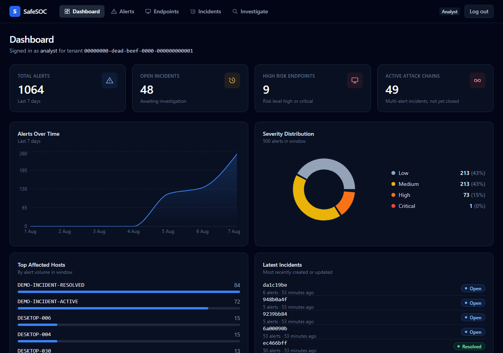
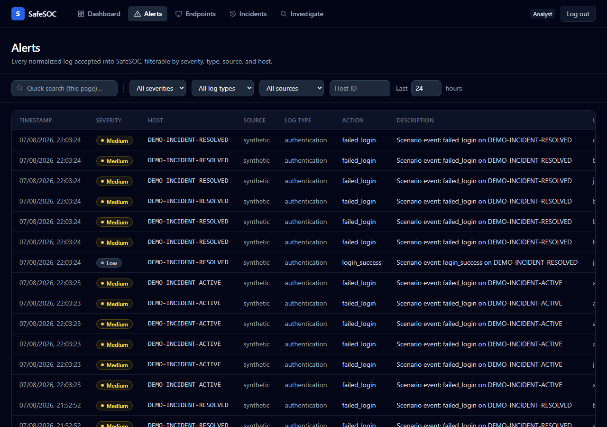
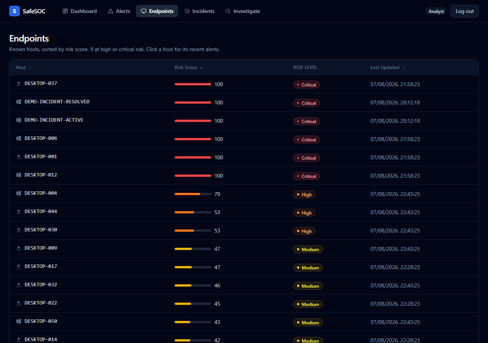
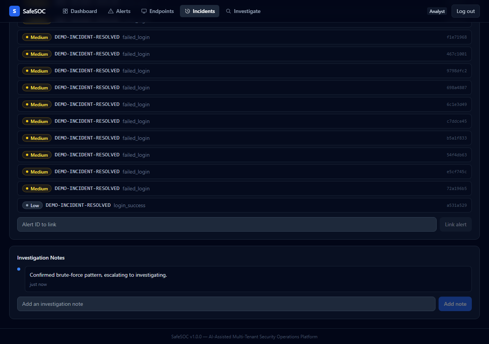
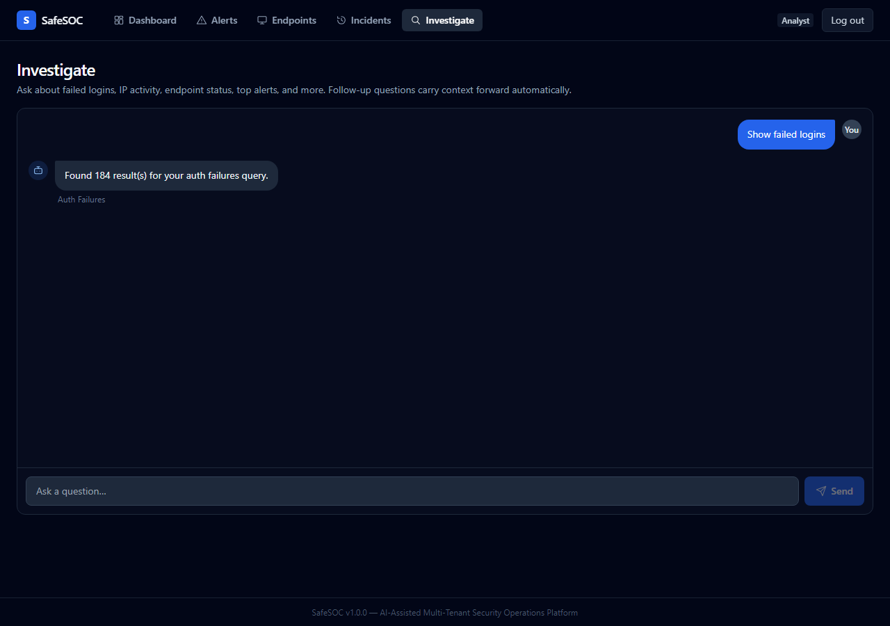
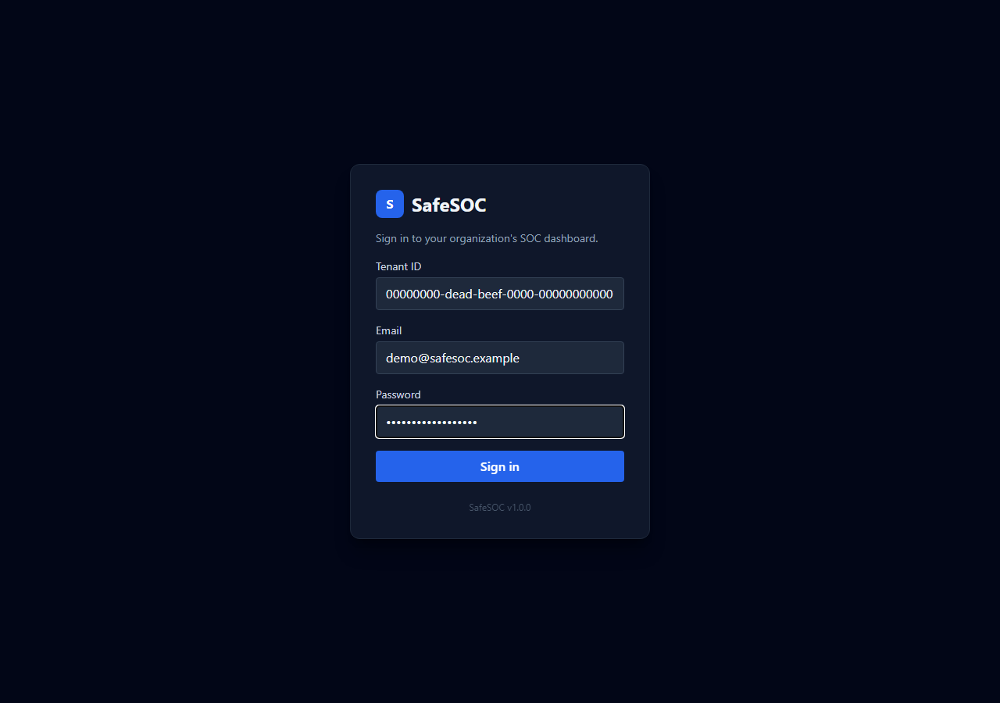

# SafeSOC

**AI-Assisted Multi-Tenant Security Operations Platform for SMBs**

Major Project (Phase 1 & 2) — Dept. of Computer Science and Engineering, SJB Institute of Technology, VTU, 2025–26.

    

## Overview

Enterprise SIEMs (Splunk, Sentinel, QRadar) cost more than most small/medium businesses can justify. Open-source alternatives (Wazuh, ELK) remove the licensing cost but not the expertise barrier — their output is raw and technical, and SMBs rarely have a dedicated analyst to interpret it.

SafeSOC doesn't try to replace detection engines — it builds an intelligent operations layer on top of them: log normalization across sources, threat intelligence enrichment, attack-chain correlation, a natural-language investigation assistant, endpoint risk scoring, and automated reporting, all as a multi-tenant, containerized platform.

> **Status: v1.0.0.** The full 68-issue engineering backlog (`docs/roadmap-issues.md`, Milestones 1–14) is implemented and tested — ingestion, auth/RBAC, threat-intel enrichment, attack-chain correlation, risk scoring, incident management, the NL investigation assistant, anomaly detection, automated reporting/notifications, the React dashboard, real-time updates, and a security-hardening pass. See [Features](#features) and [Current Status](#current-status) below for specifics, and [Phase 2 Vision](#phase-2-vision) for what's deliberately still ahead.

## Table of Contents

- [Architecture](#architecture)
- [Features](#features)
- [Screenshots](#screenshots)
- [Current Status](#current-status)
- [Installation](#installation)
- [Docker Setup](#docker-setup)
- [Demo Mode](#demo-mode)
- [AI Investigation Assistant](#ai-investigation-assistant)
- [CloudLens Integration](#cloudlens-integration)
- [Telegram Notifications](#telegram-notifications)
- [Documentation](#documentation)
- [Roadmap](#roadmap)
- [Phase 2 Vision](#phase-2-vision)
- [Team](#team)
- [Contributing](#contributing)
- [License](#license)

## Architecture

```mermaid
flowchart TD
    subgraph Sources["Source Layer"]
        Wazuh["Wazuh Agents"]
        CloudTrail["AWS CloudTrail / GuardDuty"]
        CloudLensSrc["CloudLens (AWS IAM findings)"]
        Injector["Synthetic Injector / Demo Mode"]
    end

    subgraph Ingestion["Ingestion Layer"]
        Adapters["Source Adapters\n(wazuh · cloudtrail · guardduty · cloudlens)"]
        IngestAPI["POST /api/v1/ingest\n(JWT-authenticated, batch validation)"]
    end

    subgraph Storage["Storage Layer"]
        OpenSearch[("OpenSearch\nalerts, monthly indices")]
        Postgres[("PostgreSQL\ntenants · users · incidents · ti_cache · endpoints")]
        Redis[("Redis\ncorrelation windows · sessions · pub/sub · rate limits")]
    end

    subgraph Processing["Processing Layer (Celery)"]
        Enrichment["Threat Intel Enrichment\n(VirusTotal, AbuseIPDB)"]
        Correlation["Correlation Engine\n(6 attack-chain patterns, MITRE mapping)"]
        RiskScoring["Endpoint Risk Scoring"]
        Anomaly["Anomaly Detection\n(Isolation Forest + Z-score)"]
        Reporting["Weekly PDF Reporting"]
        Notify["Notifications"]
    end

    subgraph AI["AI Investigation"]
        Investigate["POST /api/v1/investigate\n(intent classification + MCP tools)"]
        LLM["Ollama (local) / Groq (cloud)"]
    end

    subgraph API["API Layer"]
        REST["REST API (/api/v1/*)"]
        WS["WebSocket (/ws)\nreal-time push"]
    end

    subgraph Presentation["Presentation"]
        Dashboard["React Dashboard"]
        Telegram["Telegram Bot"]
    end

    Wazuh --> Adapters
    CloudTrail --> Adapters
    CloudLensSrc --> Adapters
    Injector --> IngestAPI
    Adapters --> IngestAPI
    IngestAPI --> OpenSearch
    IngestAPI -.async.-> Enrichment
    IngestAPI -.async.-> Correlation
    IngestAPI -.async.-> Notify

    Enrichment --> Postgres
    Enrichment --> OpenSearch
    Correlation --> Redis
    Correlation --> Postgres
    RiskScoring --> Postgres
    Anomaly --> Redis
    Reporting --> Postgres
    Reporting --> OpenSearch

    Correlation -.chain detected.-> Notify
    Notify --> Telegram

    Investigate --> LLM
    Investigate --> OpenSearch
    Investigate --> Postgres
    Investigate --> Redis

    REST --> OpenSearch
    REST --> Postgres
    WS --> Redis

    Dashboard --> REST
    Dashboard --> WS
    Dashboard --> Investigate
```



Full layer-by-layer implementation status: [`docs/architecture.md`](docs/architecture.md).

## Features

| Capability | Summary |
|---|---|
| **Log ingestion & normalization** | Universal `NormalizedLog` schema; batch ingestion with per-item partial-failure handling; source-specific adapters for Wazuh, AWS CloudTrail, AWS GuardDuty, and CloudLens |
| **Multi-tenant auth** | JWT-based register/login/refresh, bcrypt password hashing, role-based access (admin/analyst/viewer), Redis-backed rate limiting on login/register |
| **Threat intelligence enrichment** | VirusTotal + AbuseIPDB lookups, PostgreSQL-cached with severity-based TTLs, runs asynchronously so it never delays ingestion |
| **Attack chain correlation** | 6 detection patterns (brute force, successful compromise, recon-to-exploitation, privilege escalation, data exfiltration, lateral movement) over Redis sliding windows, mapped to MITRE ATT&CK |
| **Endpoint risk scoring** | 0–100 score with time decay, four risk levels, recalculated on a schedule |
| **Incident management** | Auto-created from detected chains (deduplicated, not one-per-re-detection) or opened manually; full lifecycle (open → investigating → resolved/false positive); alert linking and investigation notes |
| **AI investigation assistant** | Natural-language querying over 8 supported intents via MCP tool calls into existing services, conversation context carried across follow-ups, backed by a local (Ollama) or cloud (Groq) LLM |
| **Anomaly detection** | Isolation Forest over a 7-feature behavioral vector, plus Z-score network-volume-spike detection |
| **Automated reporting & notifications** | Weekly PDF digest per tenant; Telegram alerts on critical severity and detected attack chains |
| **Real-time dashboard** | WebSocket push of new alerts and detected chains over a per-tenant Redis pub/sub channel |
| **CloudLens integration** | AWS IAM risk findings bridged into the same unified alert pipeline as every other source |
| **React dashboard** | KPI overview, alert queue, endpoint risk view, incident management, investigation chat — see [Screenshots](#screenshots) |

## Screenshots

| Dashboard | Alerts |
|---|---|
|  |  |

| Endpoints | Incident Detail |
|---|---|
|  |  |

| Investigation Assistant | Login |
|---|---|
|  |  |

All captured against a live `demo.py`-provisioned tenant — nothing staged.

## Current Status

| Area | State |
|---|---|
| Log ingestion & normalization (`POST /api/v1/ingest`) | ✅ Implemented |
| Alert search (`GET /api/v1/alerts`) | ✅ Implemented |
| OpenSearch storage, monthly index partitioning | ✅ Implemented |
| Authentication / RBAC / enforced multi-tenancy | ✅ Implemented (JWT, bcrypt, admin/analyst/viewer roles) |
| Synthetic log injector | ✅ Implemented (6 named attack scenarios + one-command demo mode) |
| CloudLens (AWS IAM risk analyzer) | ✅ Implemented, standalone |
| CloudLens ↔ SafeSOC integration | ✅ Implemented (`POST /api/v1/cloud/findings`) |
| Threat intelligence enrichment | ✅ Implemented (VirusTotal, AbuseIPDB) |
| Attack chain correlation | ✅ Implemented (6 patterns, Redis sliding windows, MITRE mapping) |
| Endpoint risk scoring | ✅ Implemented |
| Incident management | ✅ Implemented (lifecycle, notes, alert linking) |
| Natural language investigation assistant | ✅ Implemented (8 intents, MCP tools, Ollama/Groq) |
| Anomaly detection (Isolation Forest) | ✅ Implemented |
| Automated PDF reporting | ✅ Implemented (weekly digest) |
| Telegram notifications | ✅ Implemented |
| Real-time dashboard updates (WebSocket) | ✅ Implemented |
| React frontend | ✅ Implemented |
| Load/performance benchmark harness | ✅ Implemented |
| Security hardening (rate limiting, JWT guard, timing-safe comparisons) | ✅ Implemented — see [`docs/security-review.md`](docs/security-review.md) |
| Single-command Docker Compose deployment | ✅ Implemented (`docker compose up --build`) |

Full detail, file-by-file, is in [`docs/architecture.md`](docs/architecture.md), [`docs/requirements.md`](docs/requirements.md), and [`docs/project-roadmap.md`](docs/project-roadmap.md).

## Installation

Prerequisites: [Docker](https://docs.docker.com/get-docker/) and Docker Compose. For non-Docker/manual setup (useful for local backend debugging), see [`docs/deployment.md`](docs/deployment.md).

```bash
git clone https://github.com/safe-soc/SafeSoc.git
cd SafeSoc
docker compose up --build
```

## Docker Setup

`docker compose up --build` starts six services: OpenSearch, PostgreSQL, Redis, the FastAPI backend, a Celery worker, and Celery beat (for scheduled tasks). No `.env` file is required — every service has a working default for local development. The backend waits for OpenSearch, PostgreSQL, and Redis to report healthy before starting.

If default ports (`8000`, `9200`, `5432`, `6379`) are already in use, override them via environment variables — see [`docker-compose.yml`](docker-compose.yml) and [`.env.example`](.env.example) for the full list.

Confirm it's healthy:

```bash
curl http://localhost:8000/health
```

Run the frontend dashboard separately (not yet part of the compose stack):

```bash
cd frontend
npm install
npm run dev
```

By default it talks to the backend at `http://localhost:8000` — see [`frontend/.env.example`](frontend/.env.example) to point it elsewhere.

## Demo Mode

Every API endpoint except `/health` requires a JWT. The fastest way to get a working demo tenant, a logged-in user, realistic alert history, and both an active and a resolved incident in one step:

```bash
python injector/demo.py
```

This prints the demo tenant's login (`demo@safesoc.example` / `SafeSOC-Demo-2026!`) at the end — use it to sign into the dashboard directly. From there, generate additional ad-hoc test data against that same tenant using any of six named attack scenarios:

```bash
python injector/injector.py --scenario brute_force
# brute_force · successful_compromise · recon_to_exploitation
# privilege_escalation · data_exfiltration · lateral_movement
```

`injector.py` logs in automatically (defaulting to the demo tenant above); pass `--tenant-id`/`--email`/`--password` to target a different user, or `--no-auth` to send the legacy unauthenticated payload shape against a backend with auth disabled. Run `python injector/injector.py --help` for the full option list.

### Example: ingest a log directly

```bash
# Get a token first (see above), then:
curl -X POST http://localhost:8000/api/v1/ingest \
  -H "Content-Type: application/json" \
  -H "Authorization: Bearer <token>" \
  -d '{
    "logs": [{
      "source": "synthetic",
      "log_type": "authentication",
      "timestamp": "2026-08-05T02:47:11Z",
      "host_id": "DESKTOP-042",
      "host_ip": "192.168.1.42",
      "action": "failed_login",
      "description": "Failed SSH authentication attempt",
      "severity": "high"
    }]
  }'
```

`tenant_id` is derived from the token, not the payload, once authenticated. Interactive API docs (Swagger UI) are available at `http://localhost:8000/docs` while the backend runs in debug mode. Full contract: [`docs/api-design.md`](docs/api-design.md).

## AI Investigation Assistant

`POST /api/v1/investigate` answers plain-English questions about a tenant's security data — "show failed logins," "highest risk endpoint," "active incidents," "attack chain summary," and more — across 8 supported intents. A query is classified, routed to the matching MCP tool (which wraps an existing service — alert search, risk scoring, incident listing, etc., not a separate data path), and answered by a local (Ollama) or cloud (Groq) LLM, configurable via `LLM_PROVIDER`. Follow-up questions carry conversation context forward automatically (Redis-backed session state), so "what about yesterday?" resolves against what was already discussed.

Try it from the dashboard's **Investigate** tab, or directly:

```bash
curl -X POST http://localhost:8000/api/v1/investigate \
  -H "Content-Type: application/json" \
  -H "Authorization: Bearer <token>" \
  -d '{"query": "Show me failed logins for host DESKTOP-042"}'
```

## CloudLens Integration

CloudLens (`cloud/`) is a separate, fully working AWS IAM risk and attack-path analyzer — Django + DRF backend, React + TypeScript frontend, with its own [`docker-compose.yml`](cloud/docker-compose.yml). It scans IAM users/roles/policies and visualizes privilege-escalation paths. Its findings are bridged into SafeSOC's unified alert stream: after a scan completes, CloudLens pushes its findings to `POST /api/v1/cloud/findings` (authenticated via a shared `X-Service-Token`, constant-time compared), where they're converted to the same `NormalizedLog` shape as every other source and flow through the identical enrichment/correlation/risk-scoring pipeline. See [`cloud/README.md`](cloud/README.md).

## Telegram Notifications

SafeSOC sends Telegram alerts for critical-severity alerts and detected attack chains. Configure `TELEGRAM_BOT_TOKEN` and `TELEGRAM_CHAT_ID` (see [`.env.example`](.env.example)) — both are safe to leave unset: notifications skip silently rather than erroring when not configured. This is SafeSOC's own bot, independent of CloudLens's own (separate) Telegram integration.

## Documentation

| Doc | Contents |
|---|---|
| [`docs/architecture.md`](docs/architecture.md) | Layer-by-layer implementation status |
| [`docs/requirements.md`](docs/requirements.md) | SRS requirements vs. actual implementation |
| [`docs/api-design.md`](docs/api-design.md) | Endpoint contracts, all implemented |
| [`docs/database-schema.md`](docs/database-schema.md) | OpenSearch mapping, Postgres/Redis schemas |
| [`docs/tech-stack.md`](docs/tech-stack.md) | Actual dependencies in use |
| [`docs/deployment.md`](docs/deployment.md) | How to actually run this today |
| [`docs/testing.md`](docs/testing.md) | Current test coverage (545 tests, CI-enforced) |
| [`docs/security-review.md`](docs/security-review.md) | OWASP-oriented security review (SS-067) |
| [`docs/decisions.md`](docs/decisions.md) | Architecture decision log |
| [`docs/project-roadmap.md`](docs/project-roadmap.md) | Milestone-by-milestone status |
| [`docs/roadmap-issues.md`](docs/roadmap-issues.md) | Full issue backlog with completion status |
| [`docs/coding-standards.md`](docs/coding-standards.md) | Conventions observed in the implemented code |
| [`docs/meeting-notes.md`](docs/meeting-notes.md) | Meeting log template |

## Roadmap

**Phase 1 (complete):** core ingestion pipeline, OpenSearch storage, CloudLens as a standalone application.

**Phase 2 (complete):** all 14 milestones of the engineering backlog — storage tier (PostgreSQL/Redis/Celery), authentication & multi-tenancy, source adapters, threat intel enrichment, attack-chain correlation, risk scoring & incident management, CloudLens integration, the AI investigation assistant, anomaly detection, automated reporting & notifications, the React frontend, synthetic data & demo mode, and non-functional hardening (performance benchmarking, security review, documentation sync). See [`docs/project-roadmap.md`](docs/project-roadmap.md) and [`CHANGELOG.md`](CHANGELOG.md) for the full history.

## Phase 2 Vision

*(Named "Phase 2 Vision" per this project's usual phase numbering, even though the engineering backlog above is itself also labeled "Phase 2" — this section is genuinely forward-looking, beyond that completed backlog.)*

Tracked in [`PRODUCT_ROADMAP.md`](PRODUCT_ROADMAP.md), which extends the original 68-issue backlog with what a real open-source SOC platform needs next:

- **Near-term (v1.0 follow-ups):** a formal API versioning policy, an audit log for compliance-sensitive actions, an installer/setup script for non-Docker environments.
- **Open-source polish (v1.1+):** contribution guidelines, security disclosure policy, release automation.
- **Research-grade bets (v2.0, speculative):** plugin architecture for third-party detectors, multi-cloud posture management beyond AWS, SOAR-style automated response.

None of this is committed or scheduled — see `PRODUCT_ROADMAP.md`'s own versioning philosophy for how these get prioritized.

## Team

| Name | USN |
|---|---|
| Shreyas Satish | 1JB23CS146 |
| Sohan Kanna D. | 1JB23CS152 |
| Tanush Somani | 1JB23CS167 |
| Vishwas Adhikari | 1JB23CS187 |

**Guide:** Dr. Krishna A N, Professor & Head, Dept. of CSE, SJB Institute of Technology

## Contributing

This started as an academic major project, not (yet) an open-source project accepting external contributions — there's no CI gate for outside PRs, no CONTRIBUTING.md, and no maintainer triage process. If you're on the project team: branch from `main`, keep `docs/` in sync with any behavior change (see [`docs/coding-standards.md`](docs/coding-standards.md)), and make sure `pytest` (backend) and `npm run build && npm run lint` (frontend) pass before opening a PR. Formal contribution guidelines are tracked as future work in [Phase 2 Vision](#phase-2-vision).

## License

See [`LICENSE`](LICENSE). *(Not yet finalized — the file is currently a placeholder.)*
